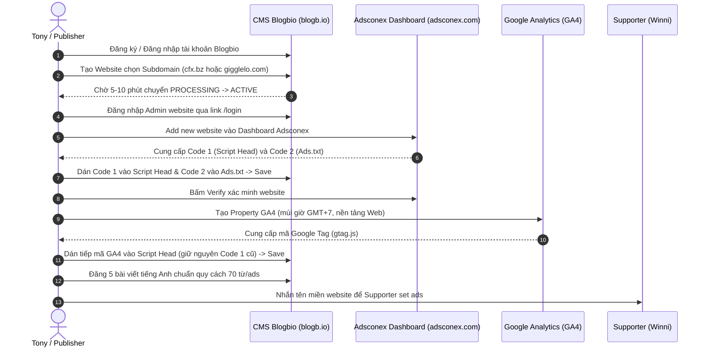

# 🛠️ SOP CHI TIẾT: QUY TRÌNH SETUP WEBSITE BLOGBIO & KẾT NỐI ADSCONEX
> **Tài liệu chuẩn hóa:** Trích xuất và tổng hợp chi tiết từ tài liệu chính thức 32 trang `HƯỚNG DẪN ADSCONEX 2026 (NEW).pdf`.  
> **Nền tảng CMS:** [blogb.io](https://blogb.io)  
> **Nền tảng Mạng quảng cáo:** [adsconex.com](https://adsconex.com)  
> **Hệ thống phân tích:** [analytics.google.com](https://analytics.google.com)

---

## 📌 SƠ ĐỒ QUY TRÌNH TỔNG QUAN

---

## BƯỚC 1: ĐĂNG KÝ VÀ TẠO TÀI KHOẢN TRÊN BLOGBIO

1. **Truy cập nền tảng:** Mở trình duyệt vào địa chỉ [https://blogb.io](https://blogb.io).
2. **Chọn đăng ký / đăng nhập:** Nhấn vào nút **Login / Sign up** ở góc trên cùng bên phải màn hình:
   * **Nếu đã có tài khoản Metaconex:** Chọn đăng nhập bằng tài khoản Metaconex ➔ Bấm **Sign in**.
   * **Nếu là tài khoản mới:** Điền Email và Password ➔ Nhận mã Code OTP xác minh được gửi về hòm thư Email để kích hoạt tài khoản.
3. **Thiết lập Bio Link ban đầu:**
   * Nhập các liên kết mạng xã hội (không bắt buộc, có thể bỏ qua).
   * Nhập tên đường dẫn cho Bio link (ví dụ: `mybrandbio`).
   * Nhập thông tin Profile và chọn một giao diện Template tùy thích ➔ Nhấn **Hoàn tất**.

---

## BƯỚC 2: KHỞI TẠO WEBSITE & CHỌN TÊN MIỀN (DOMAIN)

1. **Truy cập bảng điều khiển:** Từ giao diện Admin của [blogb.io](https://blogb.io), vào mục **My blog** để bắt đầu tạo Website.
2. **Xác thực danh tính:** Nếu hệ thống yêu cầu, thực hiện xác thực bảo mật qua Số điện thoại hoặc Email.
3. **Cấu hình Tên miền (Domain Creation):**
   * **Tên Website:** Điền tên tiền tố (subdomain) viết liền, **không dấu**, không khoảng trắng (Ví dụ: `fatefuldrama`, `whisperingsecrets`, `thesilenttruth`).
   * **Chọn Domain gốc theo đúng quy định phân nhánh:**
     * `cfx.bz`: **CHỈ DÙNG CHO BLOG TIẾNG ANH (US / UK)**.
     * `gigglelo.com`: **CHỈ DÙNG CHO BLOG TIẾNG ANH (US / UK)**.
     * `danhngon.pro`: Dùng cho blog Tiếng Việt hoặc nội dung trích dẫn.
   * **Loại trang:** Chọn **Blog** ➔ Nhấn **Continue**.
4. **Thiết lập tài khoản quản trị Site:**
   * Nhập **Username** và **Password** dùng để đăng nhập vào trang quản trị của riêng trang web này.
   * Nhấn xác nhận và đợi hệ thống tạo website trong khoảng **5 – 10 phút**.
5. **Kiểm tra trạng thái kích hoạt:**
   * Khi trạng thái chuyển từ `PROCESSING` ➔ `ACTIVE` là website đã được tạo thành công trên hệ thống máy chủ.
   * Nếu sau 5 – 10 phút hệ thống chưa tự cập nhật nhãn, bạn vẫn có thể kiểm tra trực tiếp bằng cách gõ đuôi `/login` sau tên miền để đăng nhập.

---

## BƯỚC 3: ĐĂNG NHẬP TRANG QUẢN TRỊ WEBSITE (CMS ADMIN)

1. **Đường dẫn truy cập:**
   `https://[tên-subdomain-đã-tạo]/login`  
   *(Ví dụ: `https://fatefuldrama.cfx.bz/login` hoặc `https://whisperingsecrets.gigglelo.com/login`)*.
2. **Thông tin đăng nhập:** Điền đúng **Username** và **Password** bạn đã thiết lập ở Bước 2.
3. **Giao diện làm việc chính:**
   * **Blog ➔ Post:** Quản lý danh sách bài viết và bấm **Add New Blog** để thêm bài viết mới.
   * **Setting:** Nơi cấu hình Script Head, Ads.txt, favicon, thông tin website và mật khẩu.
   * **Users:** Nơi tạo tài khoản cho nhân viên content đăng bài.

---

## BƯỚC 4: KẾT NỐI VÀ XÁC MINH MÃ QUẢNG CÁO ADSCONEX

1. **Thêm website trên Adsconex:**
   * Đăng nhập vào [adsconex.com](https://adsconex.com).
   * Vào menu **Website** ➔ Chọn nút **Add new website**.
   * Điền chính xác địa chỉ website vừa tạo (Ví dụ: `fatefuldrama.cfx.bz`).
2. **Lấy bộ mã xác thực:** Màn hình Adsconex sẽ hiển thị 2 đoạn mã:
   * **Code 1 (Script Head):** Đoạn mã JavaScript SDK nạp quảng cáo.
   * **Code 2 (Ads.txt):** Dòng khai báo chuẩn chuỗi Publisher ID phân phối quảng cáo.
   * Bấm nút Copy từng mã.
3. **Cài đặt vào Website:**
   * Quay trở lại trang quản trị Website (`/login`), vào mục **Setting**.
   * **Dán Code 1** vào ô **Script Head**.
   * **Dán Code 2** vào ô **Ads.txt**.
   * Kéo xuống cuối trang và nhấn nút **Save** để lưu lại thiết lập.
4. **Xác minh (Verify):**
   * Quay lại màn hình dashboard của [adsconex.com](https://adsconex.com).
   * Nhấn nút **Verify**. Hệ thống sẽ quét tự động trong tích tắc và báo trạng thái xác minh thành công!

---

## BƯỚC 5: GẮN MÃ GOOGLE ANALYTICS 4 (GA4) ĐỂ ĐO LƯỜNG TRAFFIC

Để theo dõi lưu lượng truy cập thực tế từ Facebook Reels US/UK và đối soát lượt Page View với Adsconex:

1. **Truy cập:** Mở [https://analytics.google.com](https://analytics.google.com) ➔ Chọn **Start measuring**.
2. **Bước 1 - Tạo tài khoản:** Đặt tên tài khoản (Ví dụ: `Mạng Lưới Blog Adsconex`) ➔ Nhấn **Next**.
3. **Bước 2 - Tạo tài sản (Property):**
   * Tên tài sản: Đặt theo tên domain (Ví dụ: `fatefuldrama.cfx.bz`).
   * Múi giờ báo cáo: Chọn **Vietnam (GMT +07:00)** để dễ theo dõi khung giờ sinh hoạt.
   * Đơn vị tiền tệ: Chọn **Đô la Mỹ ($ USD)** ➔ Nhấn **Next**.
4. **Bước 3 - Chi tiết doanh nghiệp:**
   * Ngành nghề: Chọn **Other Business Activity (Hoạt động kinh doanh khác)**.
   * Quy mô: Chọn **Medium (Vừa - 11 đến 100 nhân viên)** ➔ Nhấn **Next**.
5. **Bước 4 - Mục tiêu kinh doanh:** Tích chọn 4 tiêu chí mục tiêu hiển thị trên màn hình ➔ Nhấn **Create** ➔ Tích chọn đồng ý các điều khoản của Google.
6. **Bước 5 - Chọn nền tảng thu thập:** Chọn mục **Web**.
   * Điền URL trang web (Ví dụ: `https://fatefuldrama.cfx.bz`).
   * Điền Tên luồng (Stream name) tương ứng.
   * Nhấn **Create Stream (Tạo luồng)**.
7. **Bước 6 - Lấy và dán mã Google Tag:**
   * Tại cửa sổ cài đặt thẻ web, sao chép toàn bộ khối mã code trong phần **Google tag (gtag.js)**.
   * Quay lại giao diện quản trị website (`/login`) ➔ Vào mục **Setting**.
   * Tìm đến ô **Script Head**.
   * > [!IMPORTANT]
     > **LƯU Ý CỰC KỲ QUAN TRỌNG:** Tuyệt đối không được xóa đoạn mã Code 1 của Adsconex đang có sẵn. Nhấn phím `Enter` để xuống dòng mới, sau đó dán nối tiếp toàn bộ đoạn mã Google Tag (GA4) vào ngay bên dưới.
   * Kéo xuống cuối trang nhấn **Save** để lưu lại.

---

## BƯỚC 6: PHÂN QUYỀN USER CHO NHÂN VIÊN ĐĂNG BÀI (NẾU CÓ TEAM)

1. Từ trang quản trị website, vào menu **Users** ➔ Chọn **Add New User**.
2. Điền thông tin Name, Email, Password cho nhân sự content.
3. *Cơ chế bảo mật của hệ thống Blogbio:* Mỗi tài khoản nhân viên được cấp chỉ có quyền hạn truy cập để thêm bài viết mới và quản lý bài viết do chính họ tạo ra, không can thiệp được vào cấu hình mã nguồn hay doanh thu của Website.

---

## BƯỚC 7: ĐĂNG NỘI DUNG VÀ BÀN GIAO CHO SUPPORTER ADSCONEX

1. **Đăng bài viết:** Vào **Blog ➔ Post ➔ Add New Blog** để thêm đủ **5 bài viết mẫu** bằng Tiếng Anh (Lấy trực tiếp từ thư mục `adsconex/bai_viet_mau/`).
2. **Bàn giao kích hoạt quảng cáo:**
   * Sau khi hoàn tất đăng đủ 5 bài và gắn xong mã Adsconex + GA4, copy địa chỉ tên miền website.
   * Gửi tin nhắn cho bạn supporter **Winni Adsconex** với cú pháp:
   > *"Chào Winni, bên mình đã hoàn tất setup website và đăng đủ 5 bài viết tiếng Anh chuẩn quy cách trên domain: `https://[tên-subdomain-của-bạn]`. Nhờ bạn kiểm tra và kích hoạt set ads giúp bên mình nhé!"*
