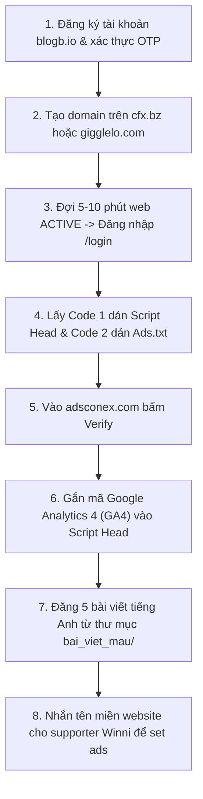

# 🚀 DỰ ÁN HỢP TÁC ADSCONEX - HỆ THỐNG BLOG MONETIZATION MỚI
> **Cập nhật:** 19/10/2026  
> **Đơn vị đối tác:** Adsconex (Hệ sinh thái Metaconex - Nền tảng CMS Blogbio)  
> **Đầu mối liên hệ supporter:** Winni Adsconex / Spring Metaconex  
> **Thị trường mục tiêu:** Tier 1 (US 🇺🇸 & UK 🇬🇧)  
> **Mục tiêu:** Xây dựng website vệ tinh từ các domain được hỗ trợ (`cfx.bz`, `gigglelo.com`, `danhngon.pro`), cấu hình mã quảng cáo Adsconex, tích hợp đo lường GA4, và phân phối 5 bài viết kịch tính chuẩn quy cách để tối ưu hóa doanh thu quảng cáo tự động.

---

## 📌 1. TỔNG QUAN TÀI LIỆU TRONG THƯ MỤC NÀY

Thư mục `adsconex/` được đóng gói toàn diện bao gồm tất cả chính sách thanh toán, hướng dẫn kỹ thuật từ tài liệu chính thức 32 trang của Adsconex (`HƯỚNG DẪN ADSCONEX 2026 (NEW).pdf`), quy cách viết bài chuẩn thuật toán 70 từ/ads và 5 bài viết content mẫu tiếng Anh hoàn chỉnh:

| File / Thư mục | Nội dung chi tiết |
| :--- | :--- |
| **`01_CHINH_SACH_THANH_TOAN_VA_CHI_SO_ADSCONEX.md`** | Chính sách thanh toán Net 30, hạn mức rút tiền tối thiểu $50, 3 cổng thanh toán (Pingpong, PayPal, Bank), khung giờ cập nhật chỉ số trên dashboard `adsconex.com`, yêu cầu traffic và thời gian đọc > 30s. |
| **`02_QUY_TRINH_SETUP_WEB_BLOGBIO_SOP.md`** | Hướng dẫn từng bước từ đăng ký tài khoản `blogb.io`, tạo domain (`cfx.bz`, `gigglelo.com`, `danhngon.pro`), cấu hình Script Head, Ads.txt, kết nối GA4 và tạo user đăng bài cho nhân sự. |
| **`03_QUY_CACH_VIET_BAI_CHUAN_ADSCONEX.md`** | Quy tắc viết bài tối ưu doanh thu: 1 câu 1 đoạn, cơ chế tự động chèn ads mỗi ~70 từ, kéo dài bài viết giữ chân độc giả > 30s, kỹ thuật bố trí nhiều hình ảnh và danh sách từ cấm nghiêm ngặt (tránh 18+, n-word, kỳ thị). |
| **`04_TONG_HOP_5_BAI_VIET_SAN_SANG_DANG.md`** | Bản tổng hợp trọn gói 5 bài viết tiếng Anh chuẩn US/UK, đúng 100% quy cách để team chỉ cần copy-paste lên web. |
| **`05_DANH_SACH_GOI_Y_DOMAIN_TIENG_ANH.md`** | Danh sách subdomain tiếng Anh chuẩn ngách Drama / Family Secrets trên nền tảng `cfx.bz` và `gigglelo.com`. |
| **`bai_viet_mau/`** | Thư mục chứa từng file bài viết riêng biệt (Post 01 đến Post 05) kèm mô tả vị trí đặt ảnh và Prompt tạo ảnh AI. |

---

## ⚡ 2. CHECKLIST CÁC BƯỚC TRIỂN KHAI NHANH

---

## 🎯 3. THÔNG TIN CỐT LÕI CẦN GHI NHỚ

1. **Quy định tên miền:**
   - `cfx.bz`: **Chỉ dành cho blog tiếng Anh** (US / UK).
   - `gigglelo.com`: **Chỉ dành cho blog tiếng Anh** (US / UK).
   - `danhngon.pro`: Dành cho blog tiếng Việt hoặc đa ngôn ngữ.
2. **Quy tắc chèn Ads tự động:**
   - Hệ thống của Adsconex tự động nhận diện bài viết: **Cứ đủ ~70 từ là chèn 1 vị trí quảng cáo**.
   - Do đó, **bắt buộc phải tách mỗi đoạn 1 câu**, xuống dòng đều đặn để bài viết trải dài, tạo nhiều khoảng trống cho hệ thống chèn tối đa số lượng quảng cáo.
3. **Tiêu chuẩn kiểm duyệt:**
   - Thời gian đọc trung bình trên trang phải duy trì **tối thiểu 30 giây**.
   - Bài viết dài từ 800 - 1.500 từ, kèm ít nhất 3 - 5 hình ảnh minh họa chất lượng cao để tăng tương tác và thời gian cuộn trang.
   - Tuyệt đối không nội dung 18+, từ ngữ phân biệt chủng tộc, thù hằn để không bị Google và hệ thống ad quét phạt.
